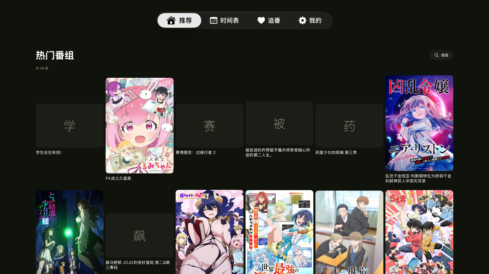
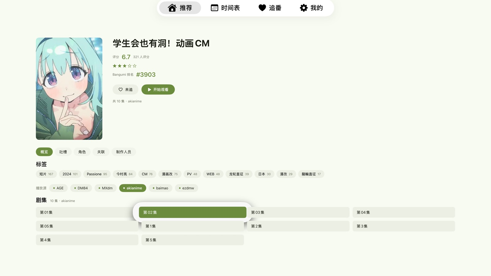
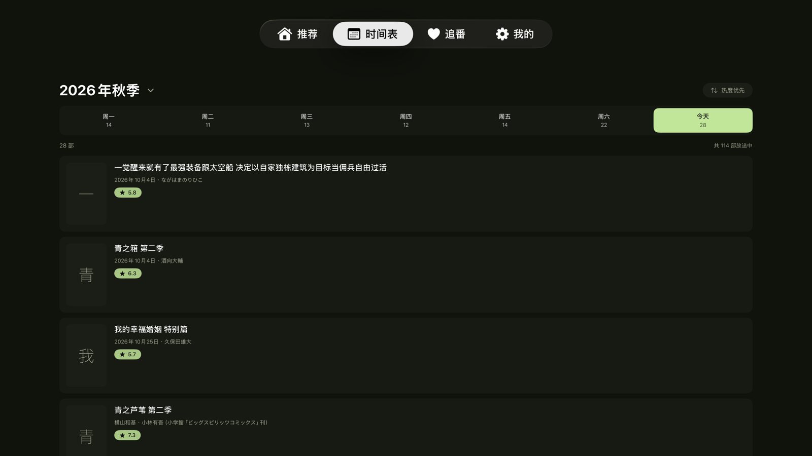
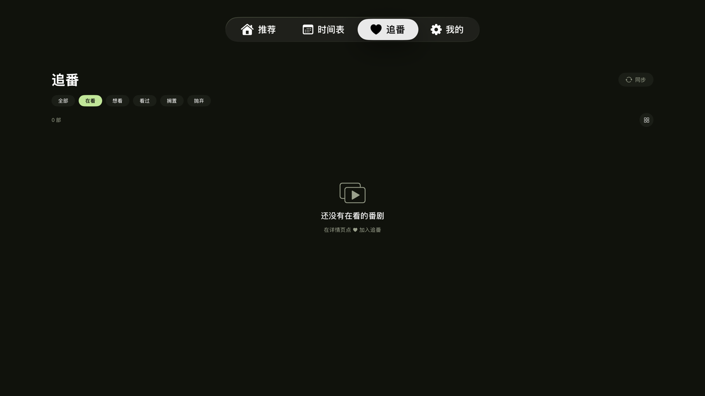
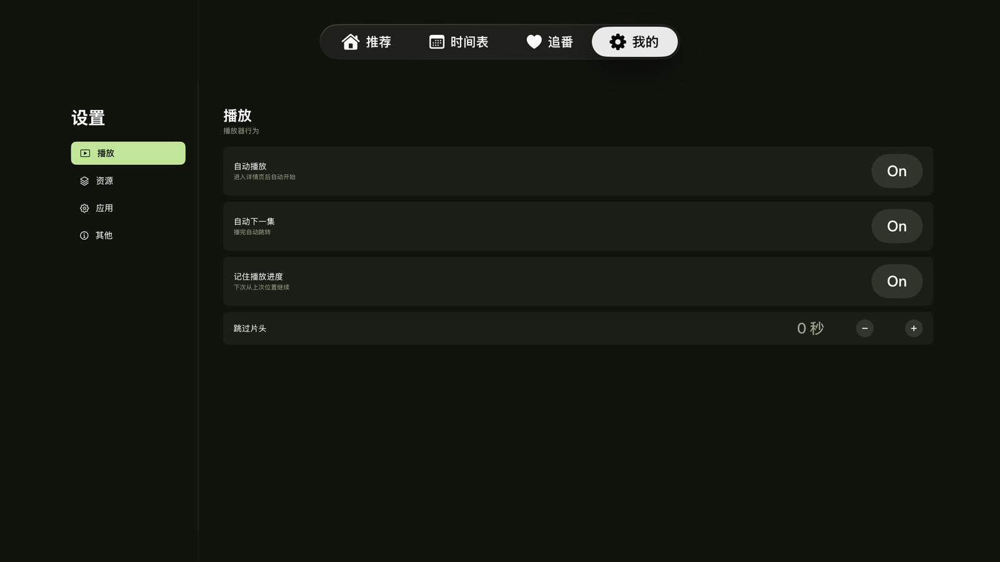

<div align="center">

# KazumiTV

**Apple TV 上的番剧采集客户端**

基于 [Kazumi](https://github.com/Predidit/Kazumi) 的规则体系，用 SwiftUI 原生重写

[](https://developer.apple.com/tvos/)
[](https://swift.org)
[](LICENSE)

</div>

---

## 截图

<div align="center">

| 推荐 | 详情 |
|---|---|
|  |  |

| 时间表 | 追番 |
|---|---|
|  |  |

| 设置 | 浅色主题 |
|---|---|
|  |  |

</div>

## 这是什么

Kazumi 是一个用 Flutter 写的跨平台番剧客户端，支持 Windows / macOS / Linux / Android / iOS。

**KazumiTV 是它的 tvOS 原生实现**——因为 Flutter 不支持 tvOS（Apple TV），无法直接移植，只能用 SwiftUI 重写整个界面层。

规则格式、数据接口、播放解析语义完全兼容 KazumiRules。

## 功能

| 已完成 | 说明 |
|---|---|
| 🔍 搜索 | 番剧搜索（Bangumi 数据） + 片源搜索，支持 `tag:` / `sort:` / `score:` 语法 |
| 🏠 推荐 | 热门番组 + 15 个官方分类标签 |
| 📅 时间表 | 一周放送表，显示每日番组数量与评分 |
| ❤️ 追番 | 5 种状态（在看/想看/看过/搁置/抛弃）+ 网格/列表双视图 |
| 📺 播放 | AVPlayer，0.25x–2.0x 倍速、定时关闭、视频详情（编码/帧率/码率/音轨）、播放中切集 |
| 🎬 解析 | MacCMS 纯 HTTP 解析：iframe 解析器、站内播放器、外部解析器三条分支 |
| 📋 播放来源 | 面板列出全部规则源与状态（N 个结果 / 需要验证 / 检索失败），只有真能解析出地址的源标记「可播放」 |
| 📋 规则 | 内置 86 条官方规则，运行时探测可用性并按历史成功率排序 |
| 💬 吐槽 | 全文显示、逐条聚焦、12 条一页手动加载、头像与相对时间 |
| 👤 Bangumi | Token 登录、评分短评提交、追番同步、剧集接口、条目磁盘缓存 |
| 🎨 主题 | 深色 / 浅色 / 跟随系统 |

| 待完成 | 说明 |
|---|---|
| 💬 弹幕 | 渲染层已就绪，需弹弹play AppId（[申请](https://dev.dandanplay.com/)） |
| 🖼️ 超分辨率 | Anime4K 需移植 Metal shader |
| 👥 一起看 | SyncPlay 协议是明文 WebSocket，可做 |
| 🔐 Bangumi OAuth | tvOS 无浏览器，改为手动粘贴 Access Token（已实现） |

## 技术要点

### MacCMS 播放解析（纯 Swift，无 WebView）

tvOS **没有 WebKit**，无法用 Kazumi 那套隐藏 WebView 截获 m3u8 的方式。

但这不代表做不了——拆开看，MacCMS 的"JS 动态解析"其实只是几步 HTTP：

```
① 播放页 HTML    var player_aaaa = {"url": "...", "from": "YDY", "encrypt": 0}
② 静态配置       playerconfig.js → player_list["YDY"].parse
③ 解析器页面     GET {parse}?url={encrypted}
④ 服务端解密     POST api_config.php {url, key, time} → 明文 m3u8/mp4
```

加密全在服务端，客户端只需发 POST。全程 `URLSession`，零外部依赖。

`encrypt` 字段的三种取值：

| 值 | 处理方式 |
|---|---|
| 0 | 直接是地址，或走解析器 |
| 1 | `URLDecode(raw)` |
| 2 | `base64 → URLDecode`（7sefun 等站） |

### 解析的三个真实难点

**① 一个剧集有多条线路，第一条常常是坏的**

同一集在不同容器下重复出现（`/play/{id}/1/1`、`/play/{id}/5/1`），线路 1 可能是会员页。
做两件事：章节按剧集名合并（「第1集」和「第01集」算同一集），其余线路记为备选；
解析时**并行**试，谁先成功用谁。AGE 因此从 47.6s 降到 1.98s。

**② 播放页里有广告 iframe**

`adposter.mp4` 这类广告位和真播放器混在一起。**不能靠 URL 后缀判断**——官方的做法是
拦截响应看内容是否以 `#EXTM3U` 开头。纯 HTTP 版同理：收全部候选，逐个请求前 64 字节验证。

**③ 采集站限流比想象中严**

7sefun 连发几次就直接回 0 字节。加了三层：页面缓存 60 秒、请求间隔 400ms、超时重试一次。

### tvOS 焦点引擎

每个可聚焦区域用 `.focusSection()` 划区，否则方向键行为不可预测。

**纯展示内容也必须能进焦点链。** 角色、制作人员、评论列表原先直接用 `VStack`，
遥控器根本滚不到那片区域，用户会以为没加载出来——给它们套一层 `focusable()` 容器就好了。

### 导航栈：别用共享单例

早期把「按名字打开详情」做成 `DetailRoute.shared` 单例，被 5 个页面同时绑定
`navigationDestination(item: $route.opened)`。结果在标签页点条目时，**所有监听它的栈都收到同一个信号**，
外层的详情页先响应，返回就回到了错的那一层。

修法：每个页面用自己的 `DetailRoute()` 实例，标签页则改用本地 `pushedItem` 驱动，
且**不要在被 push 的视图里再开 `NavigationStack`**（栈中栈会丢路径）。

## 下载

[v0.1.0 Release](https://github.com/Gdange/KazumiTV/releases/tag/v0.1.0) 提供**未签名 ipa**（696 KB）。

tvOS 应用必须签名才能安装，未签名的包需要用工具自签：

| 工具 | 说明 |
|---|---|
| **Sideloadly** | 支持 tvOS，用 Apple ID 自动签名，最方便 |
| **Xcode** | 归档后用开发者证书导出 |
| **Apple Configurator** | 企业签名场景 |

自签前提：Apple TV 开启开发者模式（设置 → 系统 → 关于本机 → 连按播放键 10 次），并与 Mac 配对。

## 从源码构建

需要 Xcode 15+ 和 tvOS 17+ SDK。

```bash
# 安装 xcodegen
brew install xcodegen

# 生成工程
cd src/tvOSClient && xcodegen generate

# 模拟器运行
xcodebuild -scheme QYTV -destination 'platform=tvOS Simulator,name=Apple TV' build

# 真机自签（需先配对 Apple TV）
./build-tvos.sh
```

## 目录结构

```
Sources/
├── App.swift                    入口
├── Source.swift                 通用 Source 协议（可插拔数据源）
└── Kazumi/
    ├── RuleCatalog.swift        官方规则仓库（index.json + 镜像回退）
    ├── RuleEngine.swift         XPath 规则解析（行内查询语义）
    ├── XPathDoc.swift           libxml2 封装
    ├── MacCMSResolver.swift     播放地址解析（核心）
    ├── BangumiAPI.swift         Bangumi 数据
    ├── BangumiExtras.swift      角色/制作/关联/吐槽
    ├── SearchParser.swift       官方搜索语法
    ├── PopularView.swift        推荐页
    ├── ScheduleView.swift       时间表
    ├── CollectionView.swift     追番
    ├── DetailView.swift         详情页（五 Tab）
    ├── PlayerScreen.swift       播放器
    ├── DanmakuLayer.swift       弹幕渲染
    └── rules/                   内置规则（KazumiRules）
```

## 关于规则

规则来自 [KazumiRules](https://github.com/Predidit/KazumiRules)，格式是 6 个 XPath 字段：

```json
{
  "name": "站点名",
  "baseURL": "https://...",
  "searchURL": "/search?wd=@keyword",
  "searchList": "//div[...]",
  "searchName": "//a",
  "searchResult": "//a",
  "chapterRoads": "//div[...]",
  "chapterResult": "//ul/li/a"
}
```

**关键语义**：规则里的 `//a` 指的是「当前行内的 a」，实现时必须当成 `.//a` 在行节点下查询，否则会把页面所有链接都匹配进来。

## 致谢

- [Kazumi](https://github.com/Predidit/Kazumi) — 规则体系、UI 设计、数据接口
- [KazumiRules](https://github.com/Predidit/KazumiRules) — 规则仓库
- [Bangumi](https://bgm.tv/) — 番剧数据

## 许可

GPL-3.0，与 Kazumi 主项目一致。
